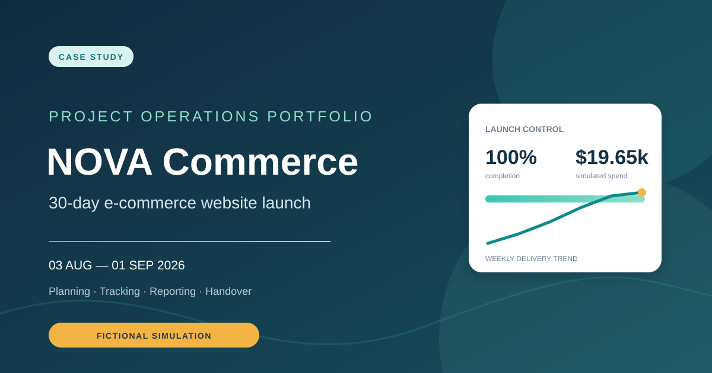
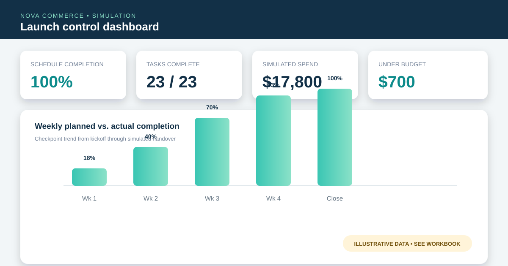
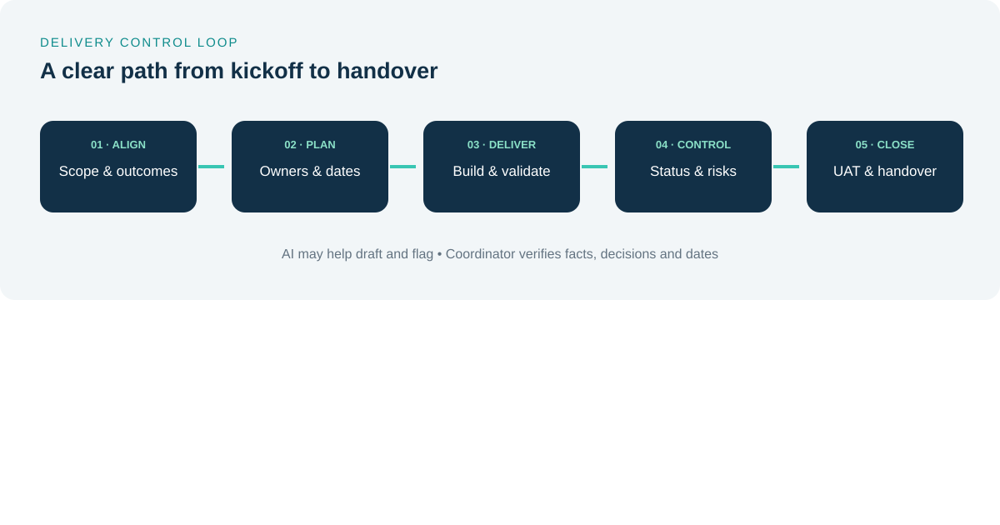

# NOVA Commerce — 30-Day E-commerce Launch

### Project Operations Coordinator Portfolio Case Study

**Fictional simulation · 03 August–01 September 2026 · USD**

[Launch Control Workbook](project-data/NOVA_Launch_Control_Executive_Refined.xlsx) · [Project Dossier (PDF)](documentation/NOVA_Project_Operations_Dossier.pdf) · [Editable Dossier (DOCX)](documentation/NOVA_Project_Operations_Dossier.docx)

> **SIMULATION NOTICE:** NOVA Commerce, its people, dates, budgets, decisions, progress, risks, issues and outcomes are fictional. This self-directed case study demonstrates skills; it is not actual client or employment experience.

## Project at a glance

A simulated 30-day delivery to coordinate the launch of an 84-SKU direct-to-consumer storefront. The scenario covers discovery, design, build, checkout configuration, analytics, quality assurance, user acceptance, launch readiness and handover.

| Delivery measure | Simulated result |
|---|---:|
| Project window | 30 calendar days |
| Baseline tasks | 23 of 23 complete |
| Schedule completion | 100% |
| Approved budget | $20,000 |
| Simulated final spend | $19,650 |
| Favorable variance | $350 (1.75%) |
| Critical issues at sign-off | 0 |

## Dashboard preview

The preview is a visual summary of the same scenario data. The workbook contains the formula-driven dashboard and detailed controls.

## How the work was coordinated

- **Plan:** define scope, acceptance criteria, owners, task dates and dependencies.
- **Track:** maintain the master tracker, milestone timeline, status and progress evidence.
- **Control:** manage budget, risks, issues, change requests and decisions.
- **Report:** summarize weekly progress, upcoming work, exceptions and sponsor asks.
- **Close:** record UAT, launch readiness, handover and lessons learned.

## What this portfolio demonstrates

Project coordination · schedule and dependency tracking · stakeholder updates · RAID management · budget variance reporting · meeting documentation · quality and acceptance tracking · operational handover · AI-assisted drafting with human review.

## Files

- [`project-data/NOVA_Launch_Control_Executive_Refined.xlsx`](project-data/NOVA_Launch_Control_Executive_Refined.xlsx) — formula-driven dashboard and charts, master tracker, 30-day timeline, risk register, issue tracker and budget.
- [`project-data/tasks.csv`](project-data/tasks.csv) and [`project-data/weekly_reporting.csv`](project-data/weekly_reporting.csv) — portable datasets.
- [`documentation/NOVA_Project_Operations_Dossier.pdf`](documentation/NOVA_Project_Operations_Dossier.pdf) — charter, SOP, kickoff minutes, daily and weekly status reports, client update and final report.
- [`documentation/NOVA_Project_Operations_Dossier.docx`](documentation/NOVA_Project_Operations_Dossier.docx) — editable dossier.
- [`PORTFOLIO_WALKTHROUGH.md`](PORTFOLIO_WALKTHROUGH.md) — interview walkthrough and transparent project framing.

## Responsible AI use

AI assistance is limited to drafting summaries, normalizing status notes, suggesting risk prompts and flagging inconsistent dates or updates. A human coordinator verifies source facts, formulas, owners, dates and decisions before sharing. No real customer, payment or confidential data is included.

## Suggested review path

1. Start with the workbook dashboard.
2. Trace a task dependency from the master tracker to the timeline.
3. Review risk responses, issues and budget variance.
4. Read the weekly reports and final report in the dossier.
5. Treat every metric and outcome as fictional scenario data.
